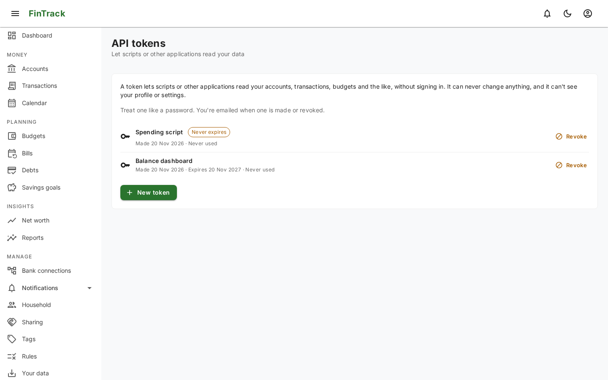

# Reading your data from scripts and other apps

An API token lets scripts or other applications read your FinTrack data without signing in. It's for showing a balance
on a dashboard, or this month's spending in a notification.

A token **only reads**. It can never change anything, and it can't see your profile, your settings, or anyone else's
data. Treat it like a password all the same: anyone who has it can read your accounts.

## Making a token

1. Open **API tokens** from the menu.
2. Press **New token**.
3. Give it a name you'll recognise, such as **Spending script**, and choose when it expires: in 30 days, 90 days, a
   year, or never.
4. Confirm it's you:
   - If you sign in with a password, enter it.
   - If you sign in through single sign-on, you're sent to sign in there again first, then come back to finish.
5. Copy the token. **You won't see it again**, so put it straight where it's needed, or in a password manager.



You're emailed whenever a token is made or revoked, so one you didn't make doesn't go unnoticed.

## Using a token

Send it in the `Authorization` header as a bearer token:

```sh
curl -H "Authorization: Bearer ftk_..." https://fintrack.example.com/api/budgets
```

A token works on these parts of the API, to read only:

- Accounts and their balances, `api/accounts`
- Transactions, including searching them, `api/transactions`
- Budgets, bills, debts, savings goals and calendar events
- Tags, pay periods, net worth, the dashboard's figures and the reports

Anything else answers **403**. Where FinTrack runs with AI, a token can instead be made for AI clients, which only
works through MCP, see [Using FinTrack from AI clients](ai-clients.md). Those tokens are refused by the API, and API
tokens are refused by MCP. A token that's wrong, expired or revoked, or whose account is locked, answers **401**.

To see every endpoint, open `/openapi/v1.json` in your browser while signed in. The endpoints a token can read list
the `ApiToken` scheme. The document is in the OpenAPI 3.2 spec.

## Expiry and revoking

A week before a token expires, and again once it has, you get a notification saying so. Make a new one and swap it in
before the old one stops.

**Revoke** on the API tokens page stops a token straight away. Revoke any token that might have leaked, and any you no
longer use. Tokens that never expire are marked, so they stand out.

Your admin can also revoke all your tokens, for example if one has leaked. You're emailed if they do.

## Limits

If too many wrong tokens come from one address, tokens from it are refused for a while with **429**, so tokens can't be
guessed. A working token is never limited, however often it's used.
