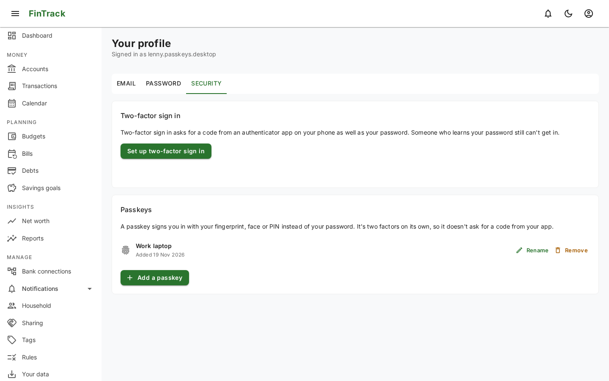

# Passkeys

A passkey signs you in with your fingerprint, face or PIN instead of your password. It lives on your phone, laptop or
password manager, and only works on your FinTrack site.

A passkey counts as two factors on its own. Something you have (the device) and something you are or know (your
fingerprint, face or PIN). So signing in with one doesn't ask for a code from your authenticator app, even with
[two-factor sign in](two-factor.md) on.

Passkeys are for accounts that sign in with a password. If you sign in through single sign-on, your identity provider
handles this instead. Your password stays, so you can always sign in with it.

## Adding one

1. Open **Your profile** and the **Security** tab.
2. Under **Passkeys**, press **Add a passkey**.
3. Give it a name you'll recognise, such as **Work laptop**, and enter your password.
4. Your browser or phone asks for your fingerprint, face or PIN, and makes the passkey.

You're emailed when a passkey is added or removed, so one you didn't add doesn't go unnoticed.

If your browser can't make passkeys, the section says so. Recent Chrome, Edge, Firefox and Safari can.

## Signing in

Press **Sign in with a passkey** on the sign in page. Your browser may also offer your passkey in the username field,
and picking it signs you in straight away.

Passkeys synced by your phone's account or a password manager work on your other devices too. **Synced to your other
devices** shows next to those.

## Renaming and removing

**Rename** changes a passkey's name. **Remove** asks for your password, then stops that passkey working. Remove it from
your device or password manager too.

## Lost a device

Remove its passkey from another device you're signed in on. If you can't sign in at all, ask your FinTrack admin. They
can remove all your passkeys from the **Users** page, then you sign in with your password. See
[Users and admins](users-and-admins.md#passkeys).
