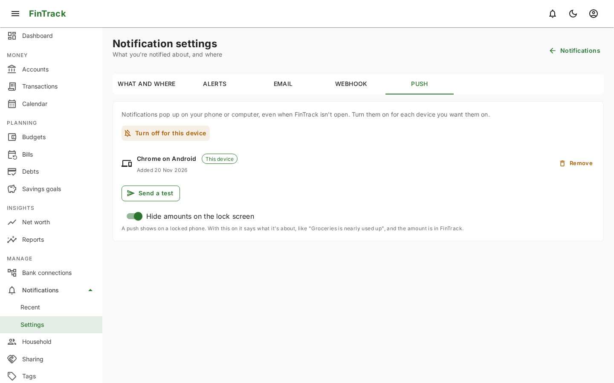

# FinTrack on your phone

FinTrack can go on your phone's home screen and open in its own window, without the browser's address bar. It can
also send you push notifications, which pop up even when FinTrack isn't open.

Both need FinTrack served over HTTPS, which it is behind the [reverse proxy](../self-hosting/reverse-proxy.md).

## Putting it on your home screen

**Android.** Open FinTrack in Chrome, open the menu, and choose **Install app** or **Add to Home screen**.

**iPhone and iPad.** Open FinTrack in Safari, tap **Share**, then **Add to Home Screen**.

Open it from the icon. When a new version of FinTrack is out, a banner says so. Press **Reload** in the banner, as the
app's window has no reload button of its own.

## Push notifications

Turn push on for each device you want notifications on.

1. Open **Notifications**, then **Settings**, and the **Push** tab.
2. Press **Turn on for this device**. Your browser asks whether FinTrack can show notifications. Allow it.
3. Press **Send a test** to check it arrives.

On an iPhone or iPad, add FinTrack to your Home Screen first and turn push on from there. Safari only sends push
notifications to apps on the Home Screen, from iOS 16.4.

If you said no when the browser asked, the tab says notifications are blocked. Allow them for FinTrack in the
browser's site settings, then turn push on.

### Which notifications

Every kind is pushed to start with. Choose which in the **What and where** tab, where **Push** gets its own column
once you've turned it on for a device.

### Amounts on the lock screen

A push shows on your phone's lock screen, where anyone nearby can read it. **Hide amounts on the lock screen** is on
to start with. A push then says what it's about without the money, for example "Groceries is nearly used up" rather
than "Groceries has £12.50 left", and you see the amount in FinTrack. Turn it off to have amounts in your pushes.

### Removing a device

**Remove** next to a device stops pushes to it. **Turn off for this device** does the same for the one you're on.
Signing out doesn't stop them, so remove a device you no longer use.

If someone else turns push on in a browser you'd turned it on in, that browser becomes theirs and your pushes stop
going there. A device whose browser has stopped taking pushes is removed by itself.

### Privacy

Pushes travel through your browser's push service, run by Google, Apple or Mozilla. Each one is encrypted so only your
browser can read it. The push service sees that a message was sent, when, and its size, but not what it says.

If an admin locks your account, pushes stop until it's unlocked.
