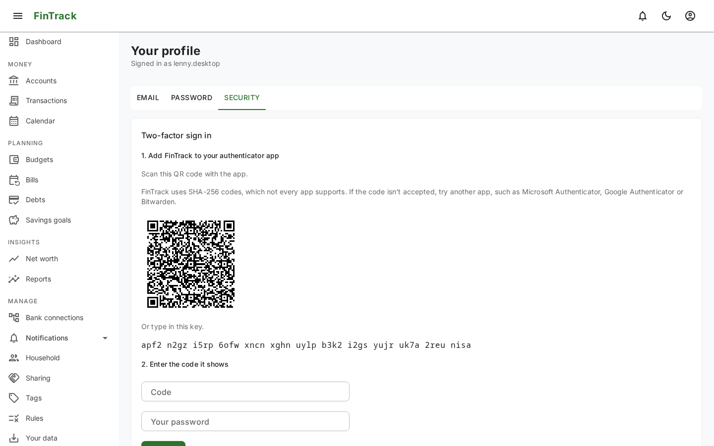

# Two-factor sign in

Two-factor sign in asks for a code from an authenticator app on your phone as well as your password. Someone who
learns your password still can't get in.

It's for accounts that sign in with a password. If you sign in through single sign-on, your identity provider handles
this instead.

## Turning it on

1. Open **Your profile** and the **Security** tab.
2. Press **Set up two-factor sign in**.
3. Scan the QR code with your authenticator app, or type in the key shown under it.
4. Enter the code the app shows, and your password, then press **Turn on**.
5. Save your **recovery codes**. They're only shown once.

FinTrack's codes use SHA-256, which is stronger than the SHA-1 many sites use. Not every app supports it. At the time
of writing, Aegis, 2FAS, Bitwarden, 1Password, Microsoft Authenticator, Google Authenticator and KeePassXC do. If your
app's code isn't accepted in step 4, try another app. Two-factor sign in stays off until a code works, so you can't
lock yourself out.

## Signing in

After your password, FinTrack asks for the code your app shows now. Each code works once.

Tick **Remember this device for 14 days** to skip the code on that browser. **Forget this browser** on the
Security tab asks for the code again.

## Recovery codes

Each recovery code signs you in once without your app, for when you don't have your phone. You get 10. Keep them
somewhere safe, such as a password manager.

To use one, choose **Use a recovery code** when asked for a code. FinTrack warns you when 3 or fewer are left.
**Make new recovery codes** on the Security tab replaces them all.

## Changes ask for your password

Turning it on or off, making new recovery codes and resetting your authenticator all ask for your password again.

You're emailed when two-factor sign in is turned on or off, or new recovery codes are made, so a change you didn't
make doesn't go unnoticed. The email goes to your confirmed email.

## A new phone

Use **Reset authenticator**. It turns two-factor sign in off and makes a new key, so your old phone's codes stop
working. Then set it up again on the new phone.

## Lost your phone and your recovery codes

Ask your FinTrack admin. They can turn two-factor sign in off for you from the **Users** page, and you can then sign in
with your password and set it up again. See [Users and admins](users-and-admins.md#two-factor-sign-in).
