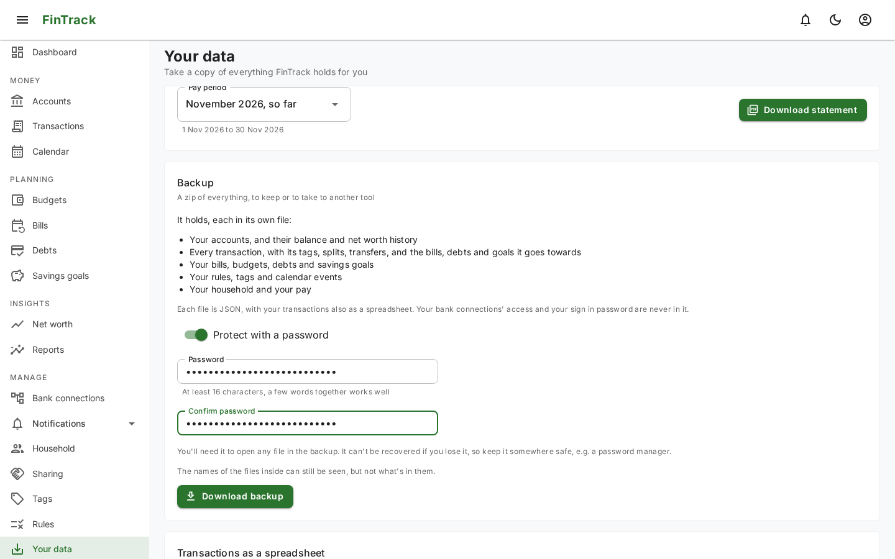

# Your data

**Your data** gives you a copy of everything FinTrack holds for you, to keep or to take to another tool.

## Statement

A PDF of one pay period across all your accounts. It has money in and out, spending by tag, your bills, budgets,
savings goals and debts, then every transaction in the period.

Pick the period and press **Download statement**. Periods run from your pay day to the day before the next. Until
FinTrack picks up your pay, they're calendar months.

## Backup

A zip with a file for each kind of data:

- your accounts, and their balance and net worth history
- every transaction, with its tags, splits, transfers, and the bills, debts and goals it goes towards
- your bills, budgets, debts and savings goals
- your rules, tags and calendar events
- your household and your pay

Each file is JSON, in the same shape the [API](api-tokens.md) returns. Your transactions are also in
`transactions.csv`, to open in a spreadsheet, and `manifest.json` says when the backup was made and how many of each
it holds. Your bank connections' access and your sign in password are never in it.

Press **Download backup**. Only you can make a backup of your data, signed in on the site. API tokens can't.

### Protecting it with a password

A plain backup is your financial data in plain text. Anyone who finds the file can read it. To stop that, turn on
**Protect with a password** before downloading.

- The password needs at least 16 characters. A few words together is long enough and easy to remember.
- Type it twice, then press **Download backup**. It's used once to encrypt the zip, then forgotten. FinTrack never
  stores it.
- **It can't be recovered.** If you lose it, nobody can open the backup, FinTrack included. Keep it in a password
  manager.

Every file in the zip is encrypted with AES-256, and needs the password to open. The names of the files can still be
seen, as zips don't hide them, but not what's in them.

Why 16 characters, when your sign in password needs 15? A protected zip turns its password into a key quickly, which
is how the zip format works so other tools can open it. That makes guessing passwords against a copied file cheaper
than against FinTrack itself, so a longer password matters more here.

## Transactions as a spreadsheet

For just some of your transactions, filter the **Transactions** page to what you want and press **Export CSV**.
