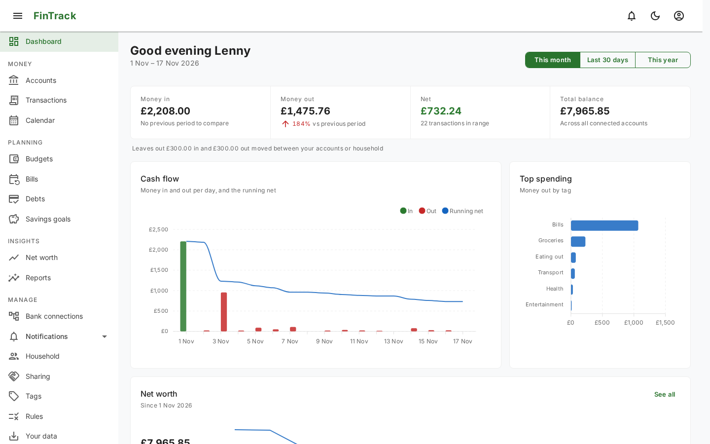
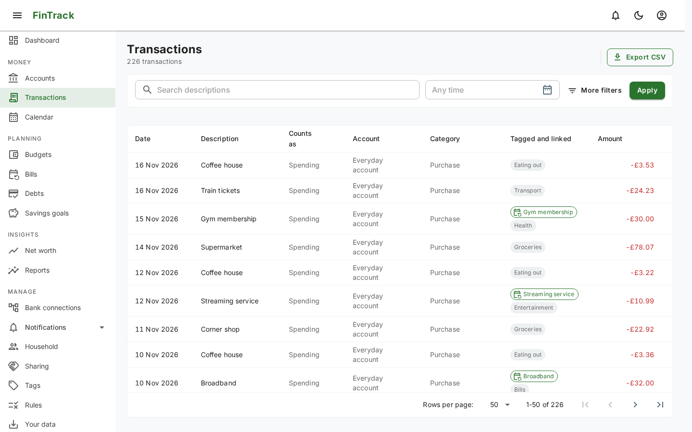
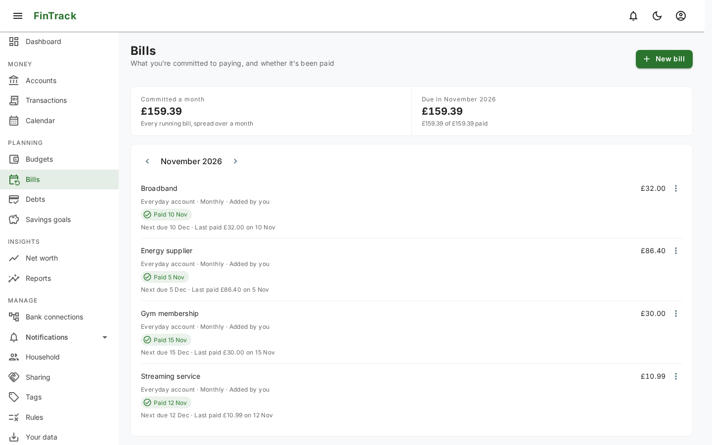
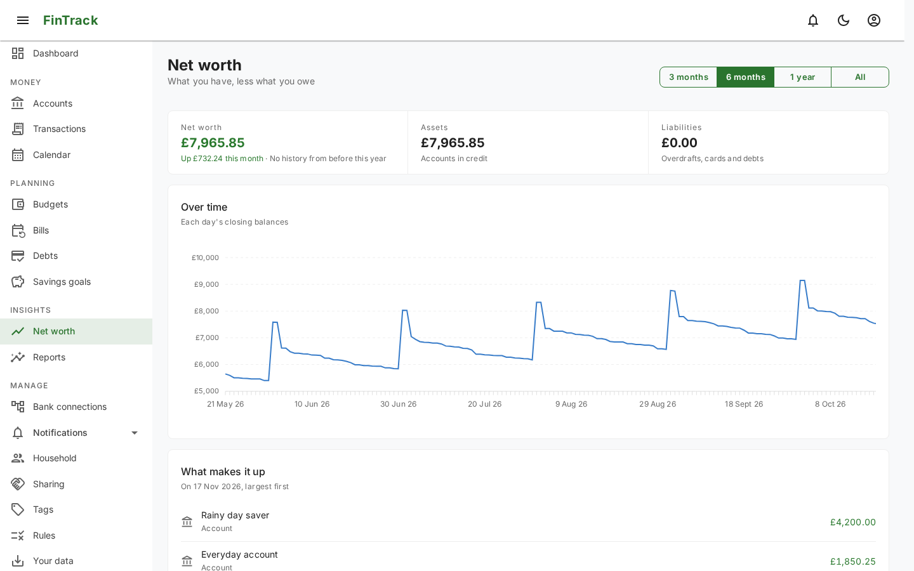
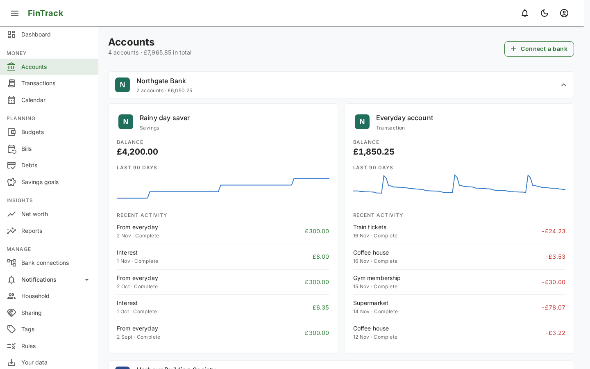
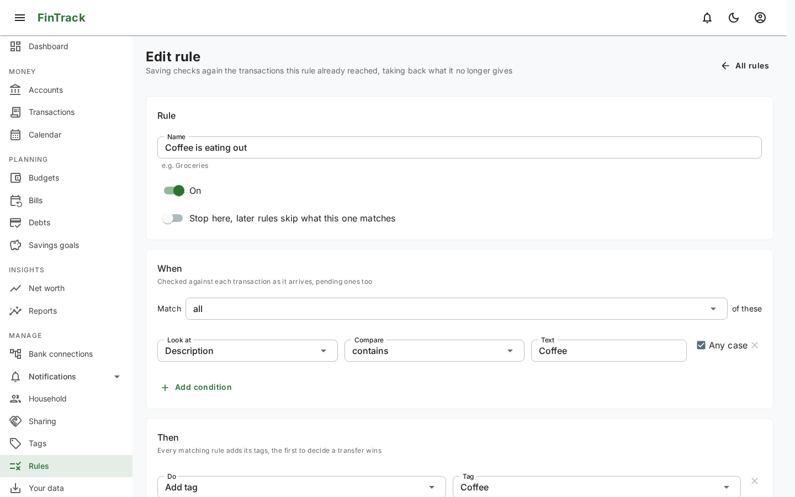
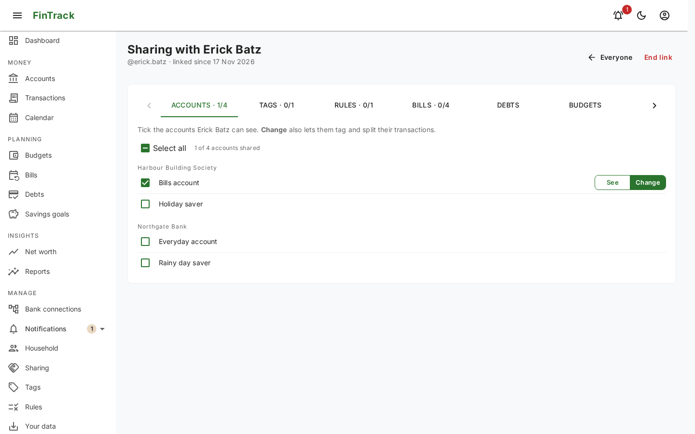
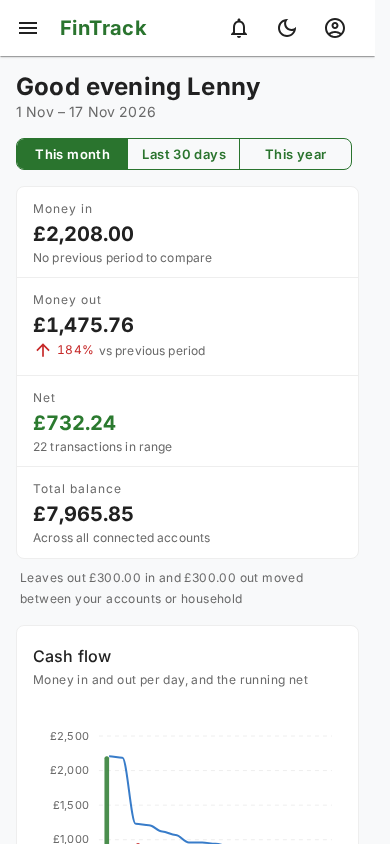
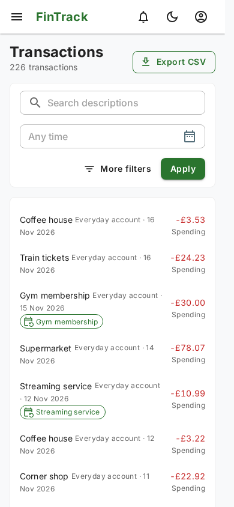
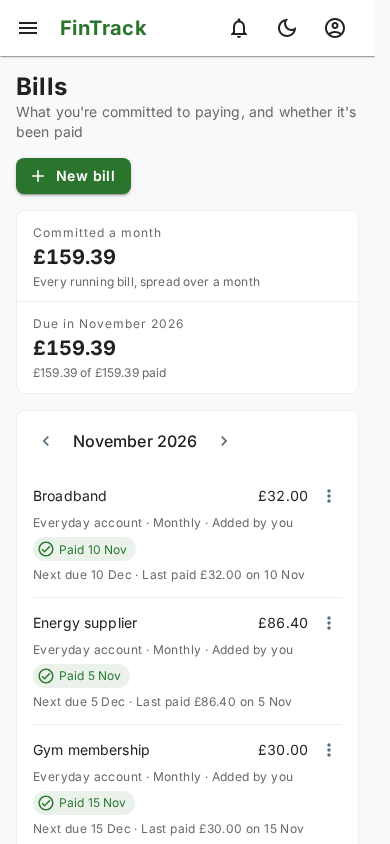

# FinTrack

A self-hosted personal finance app. FinTrack syncs your bank accounts and cards, and helps you see where your money
goes and plan what's coming.

<table>
  <tr>
    <td></td>
    <td></td>
    <td></td>
  </tr>
  <tr>
    <td></td>
    <td></td>
    <td></td>
  </tr>
  <tr>
    <td></td>
    <td></td>
    <td></td>
  </tr>
</table>

## Highlights

- **Bank sync.** UK bank accounts and credit cards through TrueLayer, synced on a schedule.
- **Transfers.** Moves between your own accounts are matched, so they don't count as spending.
- **Rules.** Tag transactions, mark transfers, and link bills and debts automatically. Preview a rule before applying
  it.
- **Bills and subscriptions.** Standing orders and direct debits become bills, and repeat payments are suggested as
  subscriptions.
- **Budgets.** Monthly limits on your tags, your accounts or both, e.g. a joint account as a whole, with rollover, and following your pay day if you like.
- **Savings goals and debts.** Track goals against an account or tags, and see when debts will be paid off.
- **Net worth.** Daily balance history for every account, back-filled from your transactions.
- **Reports and exports.** Spending reports, PDF statements and a full backup of your data.
- **Notifications.** In the app, by email or by webhook, for late bills, budgets, low balances, large payments and more.
- **Sharing.** Share accounts, tags, rules and bills with your household, and merge a joint account you've both
  connected.
- **Private.** Your data stays on your server and is encrypted at rest. Sign in with your own identity provider if
  you like.

## Tech stack

| Area | Built with |
|---|---|
| App | .NET 11, ASP.NET Core, Blazor WebAssembly, MudBlazor, ApexCharts |
| Data | PostgreSQL, Entity Framework Core, AES-256-GCM column encryption with HKDF-SHA256 derived keys |
| Background jobs | Quartz.NET |
| Open banking | TrueLayer |
| Exports and email | QuestPDF, MailKit |
| Running locally | .NET Aspire, Mailpit |
| Observability | OpenTelemetry |
| Tests | TUnit, bUnit, Playwright, WireMock |

## Getting started

- [Self-hosting](Docs/self-hosting/README.md). Run FinTrack with Docker Compose.
- [Using FinTrack](Docs/using/getting-started.md). Connect your bank and get going.
- [Development](Docs/development/README.md). Run it locally with the Aspire AppHost.

## Contributing

Contributions are welcome. Read the [contributing guide](CONTRIBUTING.md) before opening a pull request, and raise bugs, ideas and
security issues as issues.

## Licence

MIT, see [LICENSE](LICENSE).
